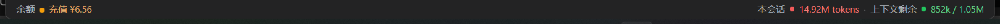

# dsh-plugin-balance-tokens

DeepSeek Harness（DSH）桌面版插件：在 Web GUI 窗口最底部显示一条状态条——左侧账户余额，右侧当前会话的 token 用量与上下文剩余。

> A status strip for the DeepSeek Harness web GUI: account balance on the left, the current session's token usage and remaining context on the right.

## 效果

- 左：`余额 充值 ¥12.34 · 赠送 ¥3.00`，点击手动刷新，每 60 秒自动刷新，页面重新可见时也会刷新。
- 余额按预警等级着色，金额前有同色圆点，悬停可看状态与阈值：

  | 颜色 | CNY | USD | 含义 |
  | --- | --- | --- | --- |
  | 绿色 | ≥ ¥20 | ≥ $3 | 余额充足 |
  | 黄色 | ¥5 – ¥19.99 | $1 – $2.99 | 余额偏低 |
  | 红色 | < ¥5 | < $1 | 余额预警 |

  等级按「充值 + 赠送」的合计余额计算；多币种时以 CNY 为主，其次 USD，其他币种沿用 CNY 阈值。
- 右：`本会话 45.6k tokens · 上下文剩余 96.1k / 128k`，两项同样分级，指标前有同色圆点：

  | 指标 | 绿色 | 黄色 | 红色 |
  | --- | --- | --- | --- |
  | 本会话 token | < 1M | 1M – <5M | ≥ 5M |
  | 上下文剩余 | ≥ 30% | 10% – <30% | < 10% |

  上下文百分比按「剩余 / contextWindow」计算。
- 截图：

  

  
- 无活动会话时显示「无活动会话」，尚未有模型用量时显示「等待用量数据」，未登录时显示「账户未登录」。
- 中英文案跟随界面语言自动切换。

## 实现方式

- 注入点：`shell.bottom`——`root` 作用域的全宽底部插槽（`ui-layout` 声明），插件通过 `ctx.slots.inject('shell.bottom', …)` 注册。
- 余额：Host 账户服务的 `account/getBalance` RPC（`ctx.remote.account.getBalance({ version, locale, timezoneOffsetSeconds })`）。凭据只在 Host 侧，前端拿不到 token。
  返回 `null`（未登录）、`{ status: 'ready', value: [...], bonusWallets: [...] }` 或 `{ status: 'failed' }`。
- 分级阈值集中在 `lib/client.js` 的 `BALANCE_BANDS` / `TOKEN_BANDS` / `CONTEXT_BANDS`；颜色只用主题 `state-success` / `state-warn` / `state-error` 令牌，文字色按比例混入 `label-primary`，保证明暗两套主题下的小字号对比度。加载中、失败、未登录、无用量数据不显示等级圆点。
- Token：会话列表快照中 Host 计算的投影 `tokenUsage` / `contextPressure`（由会话日志重放得出）；当前会话取 `retainedBy.mainView > 0` 的行。
  「本会话」按输入、缓存读写、输出四项合计分级；「上下文剩余」= `contextWindow - projectedTokens`，按剩余占比分级。

## 目录结构

```
package.json        dsh.bundle.patch + dsh.client（platform: web）
cordis.patch.yml    bundle 补丁：insert 本包为 Loader 条目
lib/index.js        node 半侧（纯 UI 插件，空 apply）
lib/client.js       浏览器半侧，已构建格式，无需构建步骤
tests/smoke.cjs     无依赖冒烟测试
docs/statusbar.png  状态条截图（README 引用）
```

`lib/client.js` 直接使用 `window.__ModuleLoader__.load({ id, factory })` 的已构建格式，仅依赖基线共享模块（react 等），不声明 `dsh.client.external`。

## 安装

桌面版 profile 为 `desktop`（由 Electron 应用管理，普通 `dsh --profile desktop` 启动会被拒绝，但 `dsh plugin` 可以管理）。

本地开发安装（推荐，改动即时生效）：

```powershell
dsh plugin --profile desktop add "link:E:\path\to\dsh-plugin-balance-tokens"
```

也可以从 Git 仓库安装：

```powershell
dsh plugin --profile desktop add "git+https://github.com/TTTimas/dsh-plugin-balance-tokens.git"
```

安装会把依赖写入 `$DSH_HOME/profiles/desktop/package.json` 并登记到 `dsh.profile.bundles`；正在运行的界面通过 HMR 实时加载，无需重启。

## 测试

```powershell
npm test
```

冒烟测试模拟 `window.__ModuleLoader__`、react 与 cordis ctx，断言注册到 `shell.bottom`、locale 字典、余额/用量渲染与点击刷新。

## 卸载

```powershell
dsh plugin --profile desktop remove dsh-plugin-balance-tokens
```

## 备注

- 注册目标 `shell.bottom` 是 `single` 插槽。若将来有其他插件占用它（例如 `experimental-inspector`），两个条目在同一 `priority` 会冲突；届时可通过注册的 `priority` 协调。
- 位置选的是全宽底部（三栏下方）；如需挪到左侧栏底部，可改为注册到 `sidebar` 内部座位。

## License

[MIT](LICENSE)
